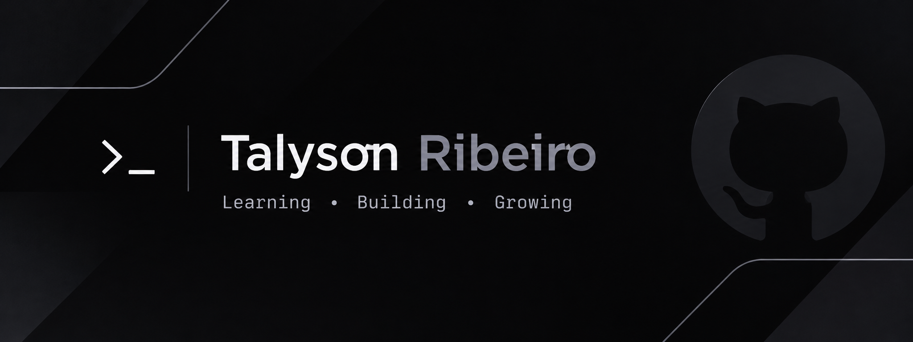

 

  

<h1 align="center">Hi, I'm Talyson! 👋</h1>

  <strong>Technology Enthusiast | Undergraduate Student</strong>

  Exploring technology, software development and new possibilities through continuous learning.

---

### 👨‍💻 About Me

- 🎓 Undergraduate student in Systems Analysis and Development (ADS).
- 💻 Interested in technology and software development.
- 🚀 Motivated by learning, solving problems and building new things.
- 🌎 Based in Sobral, Ceará, Brazil.

---

### 🎯 My Goals

To develop my technical skills, gain practical experience and grow professionally in the technology industry.

---

### 📫 Connect With Me

  <a href="mailto:talysonfrancisco00@gmail.com">
    Email
  </a>
  ·
  <a href="https://github.com/talysonfrancisco00-bit">
    GitHub
  </a>

---

  <i>Learning • Building • Growing</i>

